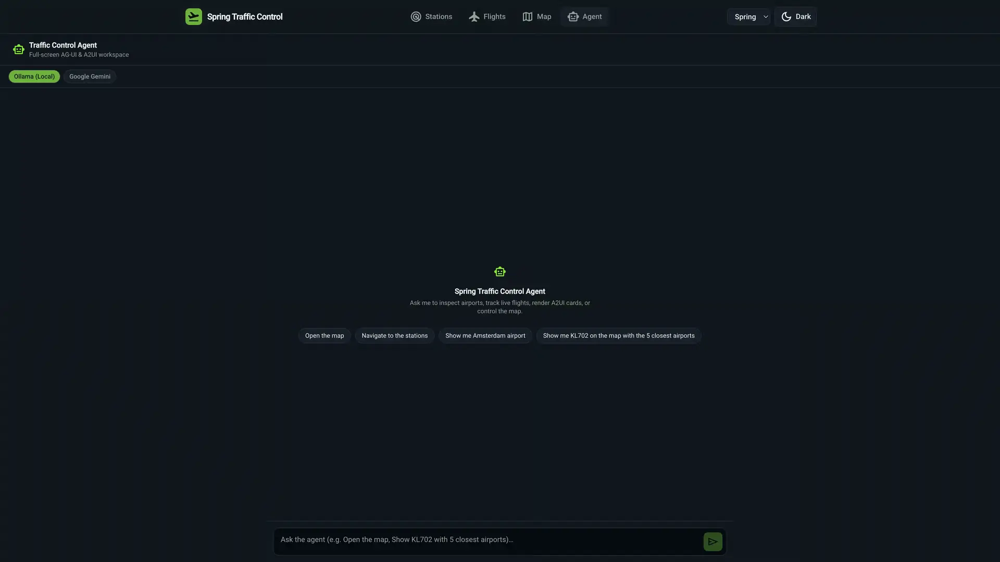

# Spring Traffic Control

An experimental **AG-UI** and **A2UI** (Agentic / Generative UI) playground built with **Spring Boot 4.2**, **Spring Modulith**, **Spring AI 2.1** (Kotlin 2.4 / Java 25), and **Angular 22** (Signals, NgRx SignalStore, MapLibre GL, Tailwind CSS v4).



## Why This Exists

Most AG-UI and A2UI examples stop at a simple todo list or weather widget. **Spring Traffic Control** is a sandbox for pushing those protocols in a much crazier, richer direction — combining live-style aviation telemetry, interactive 3D/2D maps, multi-step tool calling, voice commands, dynamic A2UI cards, and full UI control driven by local or cloud LLMs.

> **Heads up:** This is an experimental playground, not production software. Because it relies on LLM tool calling, streaming UI state, and bleeding-edge libraries, **expect odd behavior** while playing with it (creative tool choices, occasional misrouted actions, or quirky responses depending on the model you pick). That's part of the fun!

Ask the assistant — by text or voice — to inspect airports, locate live flights, highlight closest diversion airports, render interactive A2UI cards directly inside chat, or control the map, routes, layers, and seasonal themes.

## Quick Start (Standalone Demo Mode)

The repository includes a pre-imported demo seed dataset ([data/seed/README.md](./data/seed/README.md)) so you can run the full application with **zero external API keys**:

```bash
mise install
mise dev
```

- **Frontend**: `http://localhost:4200`
- **Backend**: `http://localhost:8090`
- **Demo Data**: Auto-seeds DuckDB (`data/spring-traffic-control.duckdb`) from `data/seed/duckdb/*.parquet` (763 international airports, 408 airlines, 239 aircraft types, 4,671 Schiphol scheduled flights) and serves OpenSky snapshots + **112 recorded flight tracks** from `data/seed/opensky/`.

## Repository Layout

| Path | Description |
| --- | --- |
| [`backend/`](./backend/README.md) | Spring Boot 4.2 + Spring Modulith + Spring AI 2.1 backend (Kotlin / Gradle) |
| [`frontend/`](./frontend/README.md) | Angular 22 + MapLibre GL + AG-UI/A2UI frontend (TypeScript / pnpm) |
| [`data/seed/`](./data/seed/README.md) | Compact ZSTD Parquet & OpenSky JSON demo dataset (112 documented flight tracks) |
| [`mise.toml`](./mise.toml) | Monorepo tool versions and task orchestration |

## Optional Live API & LLM Configuration

Create a gitignored `mise.local.toml` in the repository root to connect live upstream APIs or cloud/local LLM providers:

```toml
[env]
# Local OpenAI-compatible LLM (Docker Model Runner / Ollama)
OLLAMA_BASE_URL = "http://localhost:12434/engines/v1"
OLLAMA_MODEL = "ai/gemma4:E2B"

# Optional Google Gemini provider
GEMINI_API_KEY = "your-gemini-api-key"

# Optional live aviation data sources (set DEMO_MODE = "false" to disable seed fallback)
OPENAIP_API_KEY = "your-openaip-api-key"
SCHIPHOL_CLIENT_ID = "your-schiphol-client-id"
SCHIPHOL_CLIENT_SECRET = "your-schiphol-client-secret"
OPENSKY_CLIENT_ID = "your-opensky-client-id"
OPENSKY_CLIENT_SECRET = "your-opensky-client-secret"
```

## Common Monorepo Commands

```bash
mise dev       # Start demo stack (LLM check + backend + frontend)
mise build     # Build backend JAR and frontend production bundle
mise test      # Run backend JUnit 5/Modulith tests and frontend Vitest suite
```

## Observability

Start local **Redis** (OpenSky caching) and **Grafana LGTM** (OpenTelemetry traces, metrics, and Spring AI telemetry dashboard at `http://localhost:3000`):

```bash
docker compose -f backend/compose.yaml up -d
```
